# 图随我意 v1.0 · 从第一张图到投稿输出

[README](../README.md) · [安装与启动](安装与启动.md) · [故障排查](故障排查.md)

本教程截图来自 v1.0 的实际运行界面。散点和柱图由随包 CSV 与独立 Python 脚本生成，R 图由 R + svglite 生成；其余体验图为明确的示意模板。窗口宽度不同，按钮可能换行；窄窗口用“图件库”“调整图形”展开侧栏。

## 目录

- [十分钟入门](#十分钟入门)
- [认识工作台与保存](#认识工作台与保存)
- [接入自己的图](#接入自己的图)
- [文字、坐标与图例](#文字坐标与图例)
- [点、柱、箱及特殊画法](#点柱箱及特殊画法)
- [多选、快捷键和恢复](#多选快捷键和恢复)
- [拟合、相关与公式](#拟合相关与公式)
- [组合多张图](#组合多张图)
- [复用格式和批量绘图](#复用格式和批量绘图)
- [导出、投稿检查与备份](#导出投稿检查与备份)
- [接入方式决定哪些控件可用](#接入方式决定哪些控件可用)

## 十分钟入门

**目标：不懂绘图代码，也能完整体验一次修改和导出。**

1. 按安装说明启动，点“＋ 图型模板”，搜索“散点图”，选择创建。
2. 点右侧“文字”，选择标题；直接拖到合适位置，修改字号和文字。轴标题和轴数字分别调整。
3. 双击任意散点，在弹窗中改填充颜色、边线颜色和直径倍数。把应用范围选为“同系列全部点”，点击“应用散点外观”。
4. 双击图例色块改对应系列颜色。只改图例符号时关闭联动对应系列；需整组换色时保留联动。
5. 再新建一张柱图。在左侧勾选两张图前的方框，点“＋ 创建”建立组图。
6. 组图内仍可编辑文字、点和坐标。要整体移动一张子图，点“移动子图”；移动结束点“完成移动”。
7. 等待“已自动保存”，点“导出…”，选择 SVG / PDF 或 PNG，确认尺寸和透明背景，生成并下载。

**看见的结果：** 当前图件 / 组图及其修改下次打开仍保留；导出的文件位于项目 `exports`。如果暂时不需要图件，左侧删除会进入“已删除图件”，可以恢复。

## 认识工作台与保存

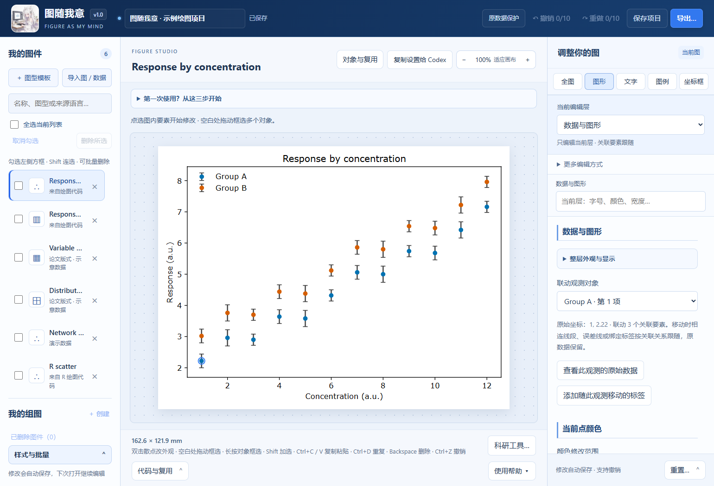

- **左侧：图件库。** 点击名称打开图，勾选方框选择组图或批量目标；全选仅针对当前搜索结果。单图和组图分列，名称可搜索。
- **中间：画布。** 白色只是预览背景，默认导出透明；上方可复制设置和缩放预览。“适应画布”只重置预览缩放，不改变导出尺寸。
- **右侧：调整你的图。** 常用“全图 / 图形 / 文字 / 图例 / 坐标框”；下拉列表还有误差、刻度、画布与组图、自由装饰等层。搜索只查当前层设置。
- **顶部：保存和导出。** 修改后等待“已自动保存”。撤销 / 重做各保留最近可用记录，最多 10 步；也可主动点“保存项目”。
- **下方：高级流程。** “科研工具…”提供数据联查、对齐辅助、版本与投稿检查；“代码与复用”查看原代码或打包项目。“复制设置给 Codex”已移到画布上方。

### 自动适配屏幕

工作台会根据窗口大小和显示缩放自动调整，无需设置分辨率。

- 大屏保留左右侧栏，放大可用绘图区；笔记本的低矮窗口会收紧间距。
- 窄窗口通过“图件库”“调整图形”打开侧栏；内容较多时在侧栏内滚动。
- 手动调整的侧栏宽度会被记住。缩小窗口时临时收窄，回到大窗口后恢复；双击侧栏内缘可恢复自动宽度。
- 调整窗口只改变预览显示，图件的毫米尺寸、图内字号、坐标和导出质量保持原设置。

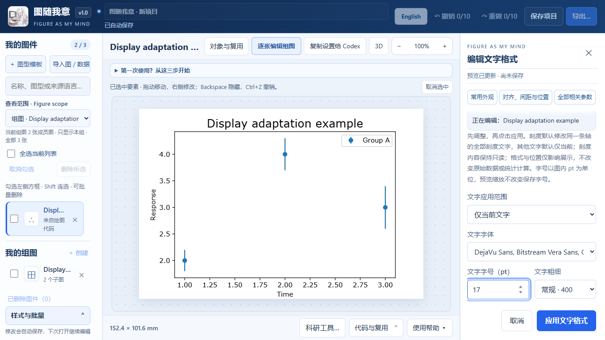

### 中英文切换

顶部原“原数据保护”按钮的位置现在是语言按钮：点击 **English** 切换英文界面，点击 **中文** 返回中文，刷新或下次打开仍沿用该浏览器站点的选择。界面语言不会翻译你的图件名、图中标题和标签，也不改变数据、源码或导出代码语言；后台原始数据保护继续自动生效。

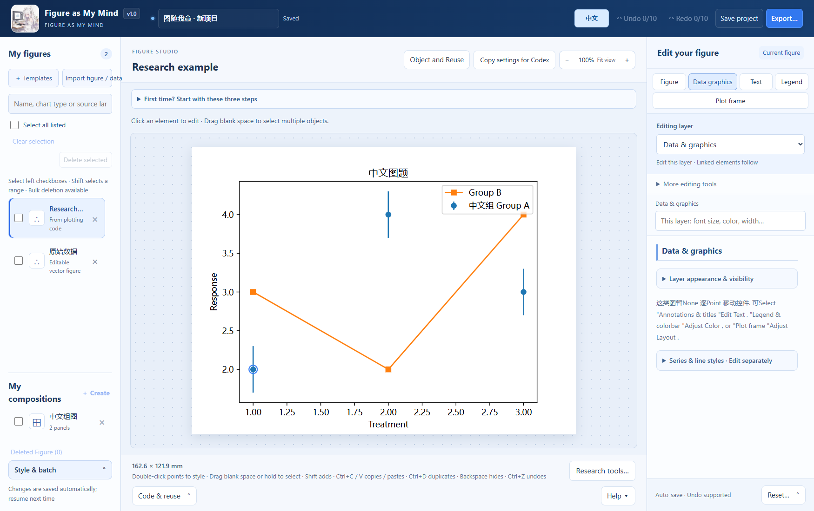

首次使用指引可收起，“使用帮助”可再次打开。进入新项目默认是空白，不会把 78 个模板全部自动生成。

### 体验模板

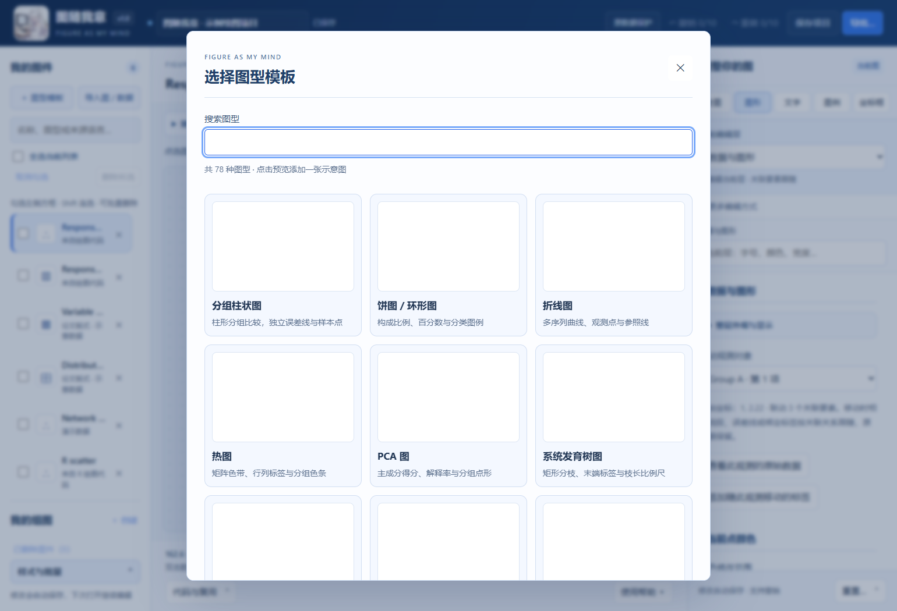

在搜索框输入中文 / 英文图型或常用别名，点击图卡创建。每个模板只有一种图型，没有内置组合页。模板用于体验版式，不能当作你的实验结果。需要真实科研图时接入自己的数据或源码。

## 接入自己的图

### 路线 A：已有 R / Python / MATLAB / C 源码

这是推荐路线。直接向 Codex 发送：

```text
使用 $figure-as-my-mind 接入我的图：
源脚本：[文件完整路径]
数据：[文件完整路径]
输出项目：[新的或已有项目完整路径]
保留原语言、原始数据和统计方法，先运行原脚本，再打开可编辑工作台。
不要覆盖项目里已保存的修改，给出可点击链接。
```

Python 的 Matplotlib 图可原生接入，点、误差与坐标等按可识别关系联动。R 优先使用 svglite 保留文本，采用来源清单登记源码和 CSV；需要点 / 误差 / 数据行联动时，让 Codex 使用 `bridge.R` 和 `bridge_semantic.R` 明确绑定。MATLAB / C 同样先执行原脚本，再登记 SVG、源码及输入。

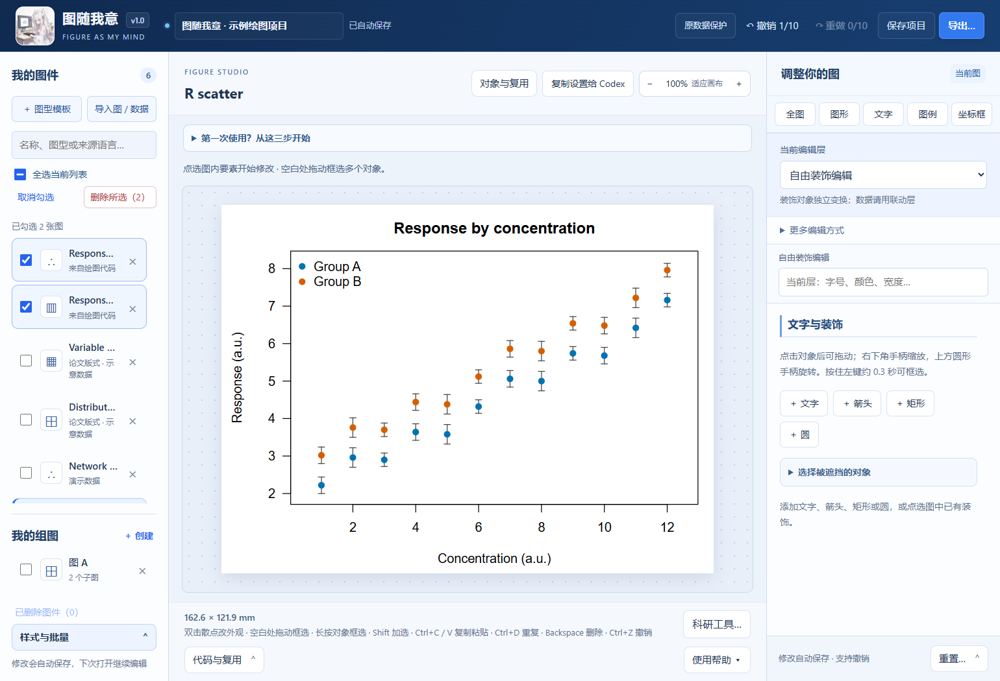

R 示例中的普通 SVG 可改文字和图形，但没有声明的观测不能直接用来做拟合。界面内核使用 Python / SVG，不等于原分析已被翻译成 Python。

### 路线 B：只有数据表

“导入图 / 数据 → 原始数据表”导入 CSV / TSV。使用“样式与批量 → 批量绘图…”选择表、图型、X / Y、分组和目标变量，先预览变量含义。

包含缺失时默认停止，明确选择按每张图排除缺失行后才跳过，图与图的样本数可能不同。工具不会根据列名猜测 PCA 预处理、统计检验、树模型或 VK 元素比；把分析要求交给 Codex 在原语言中实现。

### 路线 C：已有 SVG 或只有 PNG / JPG

SVG 可在“导入图 / 数据 → 已有矢量图”导入；自由装饰层可检索内部 ID、文字、路径和图形。路径文字可明确替换为可编辑文本，曲线可进入节点编辑；专用计算仍需源码。

PNG / JPG 先交给 Codex 结合数据重绘相似图，再导入重绘脚本。直接导入位图仅作参考，没有真实数据时必须标为示意重建。

## 文字坐标与图例

### 改标题、轴名和刻度

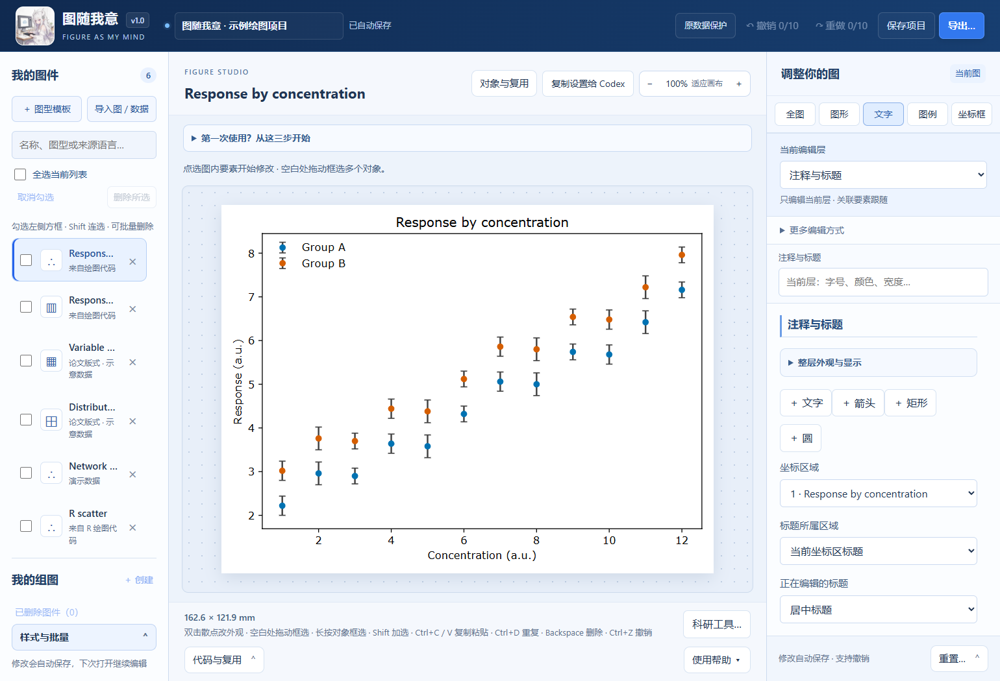

**双击文字**即可打开“编辑文字格式”，修改字体、字号、粗细、斜体、颜色和不透明度。默认仅当前文字，也可选择同一轴的刻度、同一图例文字或当前子图全部文字；取消不保存，应用一次可撤销。标题、轴名、刻度、图例文字、注释及 a / b 面板标注均可使用。


需要改文字内容、旋转和位置时，选“文字”，点击标题或注释。可选 Times New Roman、Arial 等常见字体或自定义字体，实际显示依赖本机安装。删除标题可选中后按 Backspace。

选“刻度与网格”，分别选择 X / Y 轴，以及轴标题或刻度数字；两者有独立格式。轴标题可以拖动，也可输入坐标框比例位置。右侧没有你想改的文字时，检查是否被 SVG 转成路径。

### 改范围和对数尺度

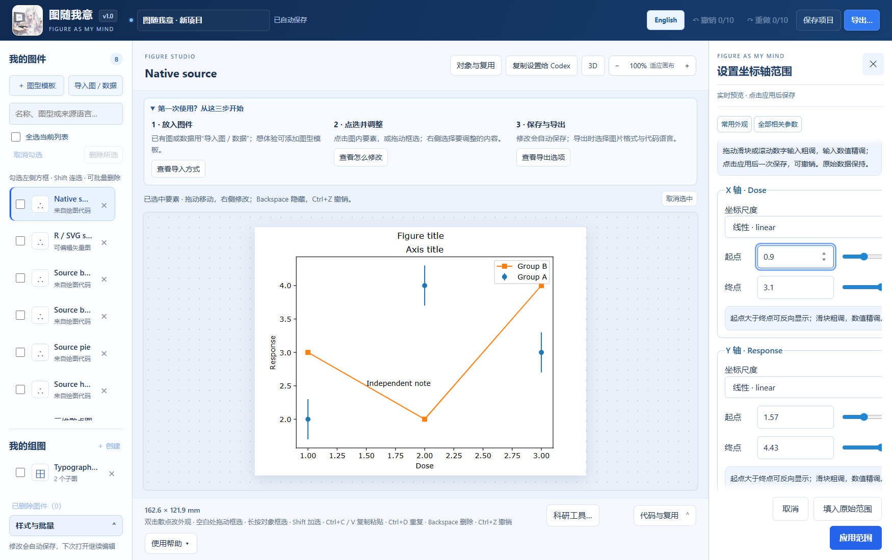

对原生二维坐标轴右键或双击打开范围编辑器，滚动面板、拖滑块粗调、输入数值精调，再应用。可选择 linear、ln、log₂、log₁₀；对数范围需为正值。尺度和范围改变会重新投影点、线和误差，原始数据不变。未知 SVG 或真实三维的特殊非线性投影需原语言适配。

**主刻度设置（Major ticks）**决定坐标轴显示哪些数字。右键坐标轴打开范围面板，在 X / Y（适用时 Z）轴下选择“按主刻度间隔”“按主刻度数量”或“自定义刻度位置”；“刻度与网格”层也有同样设置。以 0–10 为例：间隔 5，或数量 3，显示 **0、5、10**；间隔 2，或数量 6，显示 **0、2、4、6、8、10**。数量包含两端，所以 6 个刻度分成 5 个区间。面板显示数值预览，应用后可撤销；按间隔 / 数量会跟随当前范围重算，对数轴数量按对数等距。分类 / 日期轴保留原标签，日期间隔需回原语言设置。

选“坐标框”，可从框内任意位置拖动；四边和四角手柄调整长宽。四侧边框可独立设置颜色、线宽和外移；附加轴需要明确换算或独立刻度，不会自动把任意系列分配给新轴。固定比例、极坐标、地图和 3D 遵守相应比例约束。

### 图例不只是一个色块

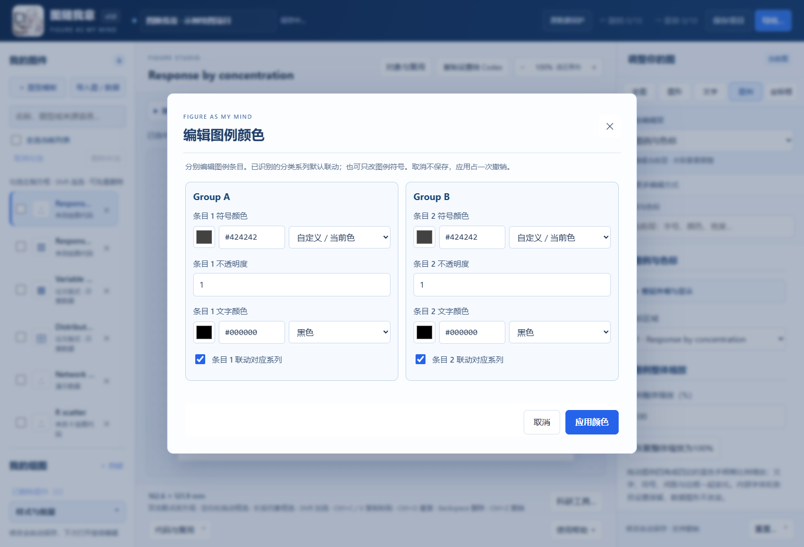

双击分类图例的**符号或空白**，为每个条目设置符号颜色、不透明度和文字颜色。默认联动已识别的对应系列，适合把所有 Group B 柱 / 点一起换色；复杂代理图例无明确系列关系时，只修改图例符号，不猜测数据身份。误差线颜色独立。

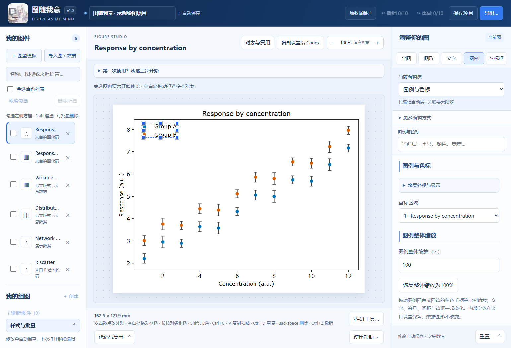

在“图例”层拖动整体、用八向手柄或百分比缩放。可设置横排 / 竖排、列数、填充顺序、条目次序、符号在文字左 / 右 / 上 / 下、间距和图例框。精细编辑时选择整体、条目、文字或符号：改 Group A 与 Group B 的相对位置，而不移动整张图例。

### 连续色带与离散区间

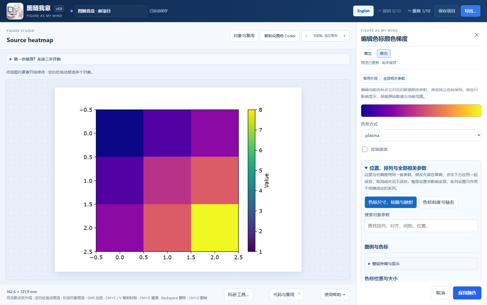

双击热图、等值线或地图的色标，按图形实际映射显示连续梯度或分级区间。连续渐变可选预设、反转、增删颜色节点、设置位置与透明度；离散区间逐项改色。图中有多个色标时只修改双击的那个。所有颜色选项可设“透明 / 无色”，透明度仍单独保存。颜色改变不改数值区间和数据。

SVG 接入的色带也可双击编辑。首尾节点可以位于 20% / 80% 等原位置；相同位置的两个节点可保留突变色阶。各节点的位置、颜色和透明度独立设置，SVG 最多 256 节点；原生数值色带仍按 2–32 个严格递增节点处理。颜色自身的 alpha 与节点透明度会共同保留，现代 SVG 颜色也会正确换算；不会因为修改其他节点而使半透明颜色变实或变黑。

### 修改整条轴的分类标签与角度

双击 X 轴上的任意分类标签（如 Control、Low、High），默认范围是“同一条 X 轴的全部刻度文字”，改字号、字体、颜色或旋转后会统一应用到这一条轴。Y / Z 轴刻度采用相同规则，其他轴和轴标题保持独立。需要单独精修时，把范围切换为“仅当前文字”。

**斜体与角度分开设置：** “字形样式（正体 / 斜体）”只改字形；“文字旋转（度）”可输入 22.5 等任意有效角度，也可选择 0°、30°、45°、60°、90°或负角度。刻度正角度逆时针、负角度顺时针；输入的是目标角度，修改多次不会累加。取消不保存，一次应用可以一次撤销；分类名称和原始数值保持只读。

### 在侧栏中观察并编辑

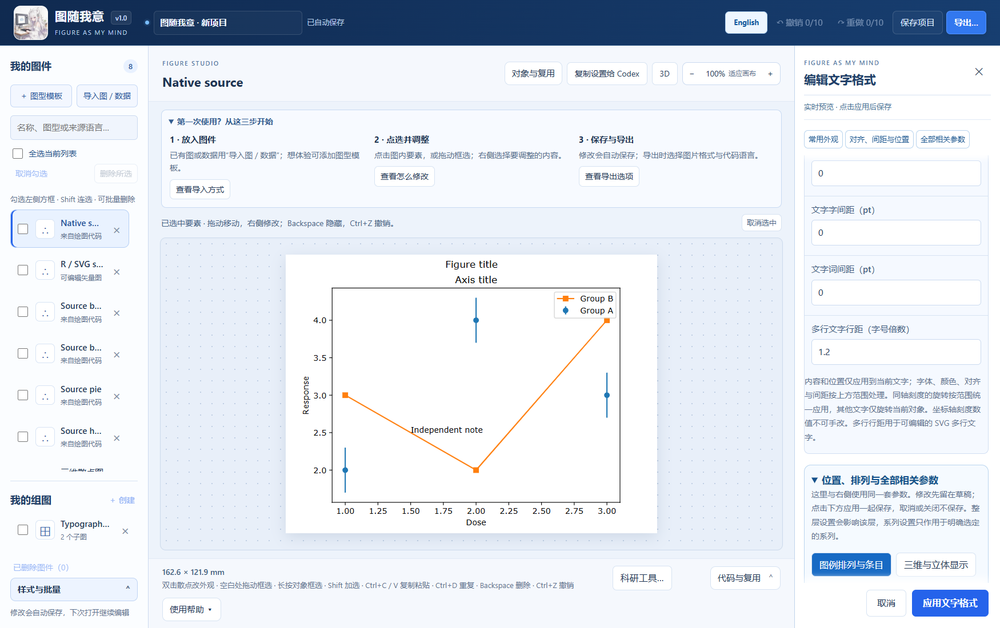

双击对象后，编辑器固定在右侧原“调整你的图”区域。左侧图件库不消失，桌面绘图区的大小、位置保持不变；窗口较窄时上下排列。输入后图中实时预览，方便直接观察；无效输入会提示并保留上一幅有效预览。上部先显示常用外观；需要更多设置时，展开下部“位置、排列与全部相关参数”，或点击顶部“全部相关参数”。这些设置按需加载，避免打开常用编辑时同时构建大量控件。在“搜索对象参数”中输入排列、间距、边框等词即可查找，匹配的折叠区会展开。

| 双击对象 | 相关参数 |
| --- | --- |
| 文字、标题、a / b 标注 | 内容、字体、粗细、斜体、颜色、对齐、基线、字词间距、旋转与位置；自由 SVG 多行文字另有行距 |
| 分类图例的文字或符号 | 横排 / 竖排、列数、填充顺序、条目顺序、符号方向、文字与符号独立位移、行列间距、整体缩放和边框 |
| 连续 / 分级色标 | 渐变 / 区间配色、宽高、位置、轴名、刻度、数值映射范围和归一化 |
| 散点、柱、箱或扇区 | 明确对象的外观、系列、专用画法及适用的宽度、拟合与误差参数 |
| 坐标轴 / 绘图区空白 | 范围与尺度、坐标框尺寸、四侧边框、轴名、刻度、网格和标题 |
| SVG 装饰形状 | 填充、边线、透明度、几何尺寸、位移、旋转与缩放 |

修改先留在草稿，实时预览不保存项目，点击侧栏底部的应用按钮才一起保存；取消、Esc 或右上角关闭均丢弃草稿。一次应用占一次撤销。先看控件标明的当前对象 / 系列 / 坐标轴 / 子图范围；整层设置会修改对应层。刻度数值和自动生成的公式内容不能手改，原始数据保持只读。普通 SVG 只开放已经接入的图形参数。

## 点柱箱及特殊画法

### 调整饼图 / 环形图大小

单击或双击某个扇区，在“扇区与饼图大小”里选“仅当前扇区”，修改“所选扇区大小（%）”即可只放大它。框选多个扇区后，右侧的同名设置只调整所选部分；全选同一饼图的扇区时会整体放大 / 缩小，也可直接设置“饼图整体大小（%）”。

单个扇区的倍数基于当前整体大小，整体缩放以原图为基准；对应标签位置跟随，标签字号、独立图例、原始数据和扇区角度保持。支持取消草稿、撤销和保存后继续编辑。

### 调整三维与立体画法

点击画布上方 **3D**，在右侧“图形维度”中选择适用画法，图中实时预览：

- 柱、饼 / 环形、折线、散点 / 气泡、箱线、小提琴、直方等提供立体显示，可调整展示厚度。
- 热图可选择“三维曲面”或“三维柱格”，高度使用矩阵中的原数值；等值线可用已知等值作为高度。
- 已有真实 XYZ 的图直接调整三维相机。

进入三维后，可直接在图上操作：

- **左键拖动**旋转，**滚轮**缩放，**Shift＋拖动 / 右键拖动**平移。
- 右侧滑块粗调，数字输入精调；双击图面或点击“恢复三维视图”复位。
- 点击“倾斜 / 压缩”，左右拖动调整倾斜，上下拖动调整压缩；展开同名折叠区设置 a / b / c / d，各系数不会自动改变整体缩放。
- 拖动时显示轻量几何预览，松开后恢复精确坐标文字 / 深度明暗与 SVG 排版。**应用三维设置**保存一次；取消恢复。可用“复制三维设置”复用相机与投影。

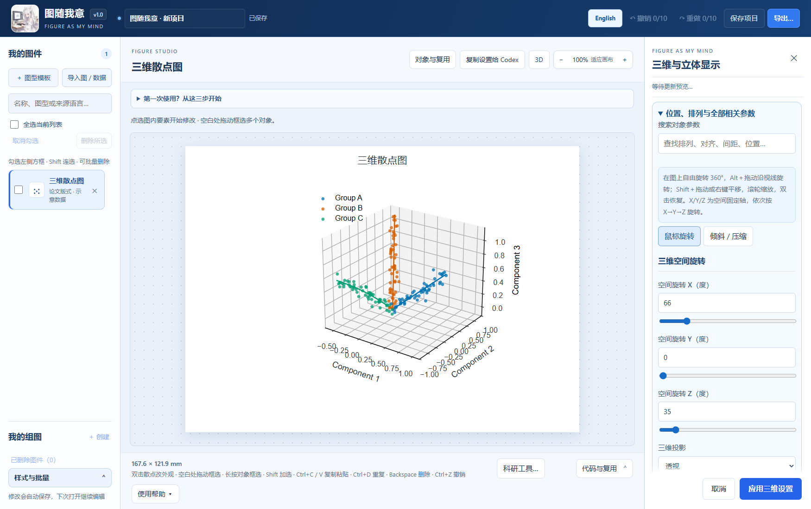

下方可调整 X/Y/Z 空间旋转角（各 0–360°）、透视 / 正交、XYZ 比例、缩放、背景面和网格。展示厚度不表示新增的测量变量。切回“二维原图”可恢复原画法；取消不保存，应用后可撤销；组图只影响当前子图。普通平面 SVG 需要原代码提供 XYZ 或三维几何后才能获得真实三维相机。

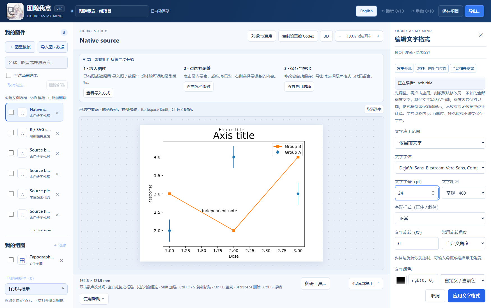

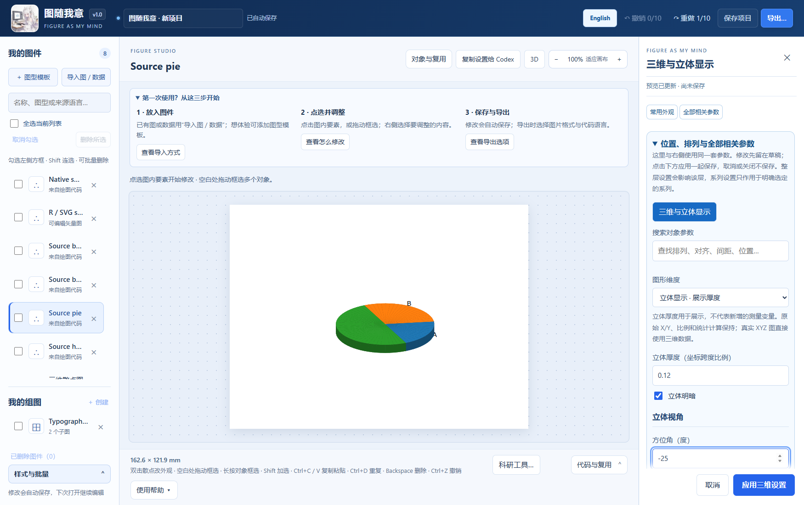

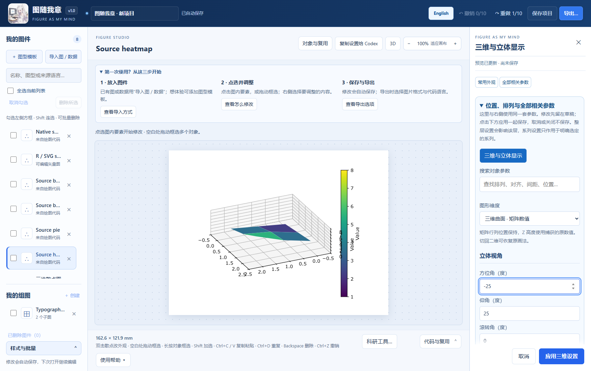

### 双击散点改外观

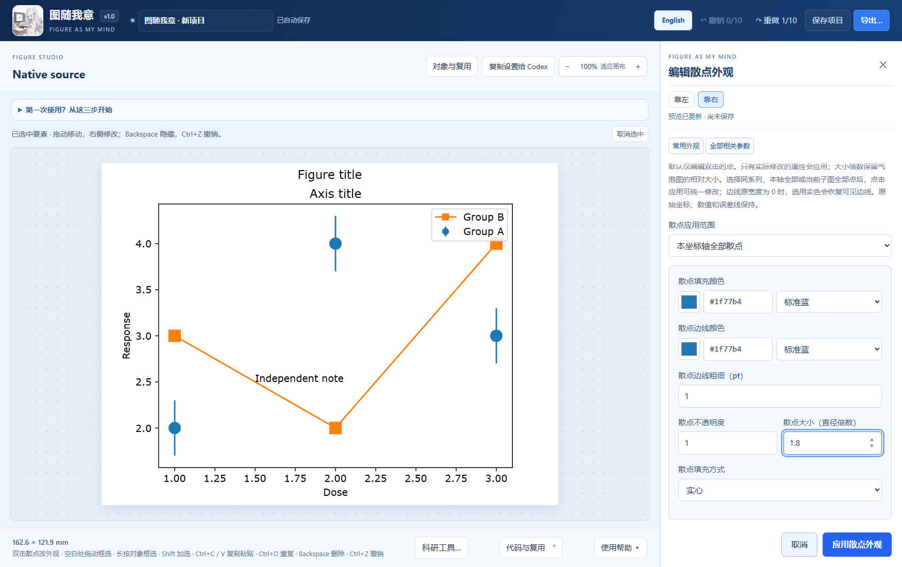

选择填充、边线、线宽、透明度、形状和大小。“仅当前点”保留单点特征；“同系列 / 本轴 / 当前子图”可批改。气泡大小采用直径倍数，保留相对大小。只有实际改动的属性会应用；点击取消不保存，应用一次可撤销。数据层主体颜色不会强制改误差杆。

### 柱 / 箱体宽度和画法

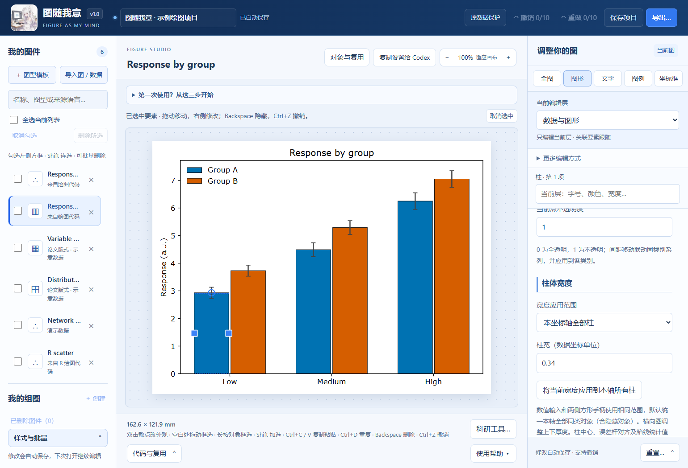

选中柱或箱后，调整“宽度应用范围”，再拖两侧方形手柄或输入宽度。默认统一本轴同类对象；可只改当前或同系列，误差、箱线中位线和须线保持对齐。

柱图可按输入结构选择簇状、堆积、百分比堆积等；箱线图可选择显示所有点、异常点 / 箱外点或不显示点，选择范围与中心统计量。中位数、均值、须线和端帽在“误差与区间”层独立编辑。

**不要用拖动改变实验数值。** 柱 / 箱沿数值方向的移动被阻止；分类方向可调相对间距。同分类多个柱联动保持组中心，并应用到各类别。

### 其他图型

折线可以改连线方式、线型和标记；混合点形 / 逐点颜色默认保留。网络图可选原始、力导向、圆环、同心圆、分组圆簇、谱或网格布局，固定种子保证可重现；拖动有明确拓扑的节点时，边与标签跟随。地图提供投影、经纬网、范围、比例尺和指北针等适用参数。真实 3D 原生图可调整视角与相机；普通 SVG 投影不能旋转出新的三维视角。

图型专用选项只在输入数据与语义足够时出现，不因画面有一条线就把它当成回归样本或普通折线。

## 多选快捷键和恢复

无需打开“框选”按钮。在空白处按住左键拖动，或在对象上按住约 0.3 秒后拖出选框；Shift 加选，Ctrl / Command 点选切换。框选后可整体拖动，或在右侧统一颜色、字号、线宽和适用宽度。观测与误差 / 标签的关联移动会去重。

| 快捷键 | 操作 |
| --- | --- |
| Ctrl / Command + C、X、V | 复制、剪切、粘贴所选图形要素 |
| Ctrl / Command + D | 重复所选要素 |
| Ctrl / Command + A | 画布内全选；焦点在图库时全选当前列表 |
| Backspace / Delete | 隐藏所选要素；图库焦点下进入图件删除流程 |
| Ctrl / Command + Z | 撤销 |
| Ctrl / Command + Shift + Z，或 Ctrl + Y | 重做 |
| Esc | 清除当前选择 / 关闭相应界面 |
| 方向键 / Shift + 方向键 / Alt + 方向键 | 微调 1 / 10 / 0.1 预览像素 |
| Alt + 拖动 | 临时跳过文字 / 装饰吸附 |
| Ctrl + Alt + C / V | 复制 / 粘贴选择性外观 |

输入框内仍优先使用普通文字编辑快捷键，不删除整张图。复制出的观测副本是装饰，不增加统计样本。右侧“更多编辑方式”保留复制粘贴、格式刷、同类 / 同组选择、找回隐藏要素和原图对照。

“重置…”可复位当前对象、恢复本层格式或恢复导入时原始图；原始图指当前来源版本的初态，不是刚刚保存那一步。重要阶段可使用“科研工具…”保存命名版本。图件删除进入左侧“已删除图件”，要素隐藏通过右侧工具找回，两者不同。

## 拟合相关与公式

在有真实原生二维 XY 观测的图形层展开“拟合、相关分析与置信区间”，选择参与系列、逐组或整体拟合，再选择线性 / 其他回归方法或 Loess 局部平滑。置信水平、色带、线型和适用参数可以单独设置；检查方法假设和样本含义。

Pearson 是线性相关、Spearman 是秩相关，属于相关分析选项，不是两种独立回归线。可以与回归同时报告，也可以只算相关。启用公式 / 统计文字后，在文字层选中对应公式，改字号、颜色、背景与位置，或直接拖动。

拟合始终用原始捕获观测；隐藏点仍计入。汇总曲线采样顶点不自动成为独立样本。无原生数据的 SVG 不从像素推算回归，复杂统计模型应在原 R / Python 分析中重算后重新接入。

## 组合多张图

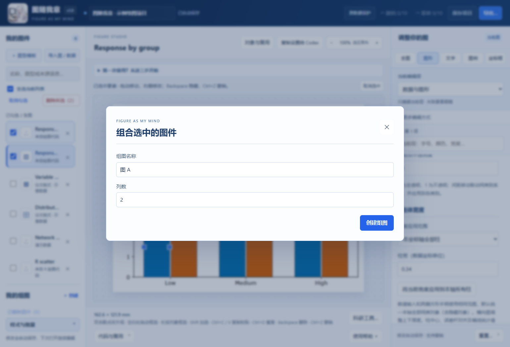

1. 左侧勾选至少两张单图，点“＋ 创建”，选择名称和列数后确认，画布尺寸稍后在右侧调整。
2. 组图内部默认能直接改坐标、文字、图例和数据外观。选中不同子图，右侧作用范围随之更新，来源单图不回写。
3. “移动子图”进入容器拖动模式，可从内部任意位置拖整张子图，附近图形按吸附 / 邻图跟随规则调整。点“完成移动”返回精修。移动标签位于图框外，避免遮住标题和 a / b / c；旋转过的标注也会随子图一起移动。
4. “锁定画布布局”固定容器的位置与大小，仍能修改图内要素。

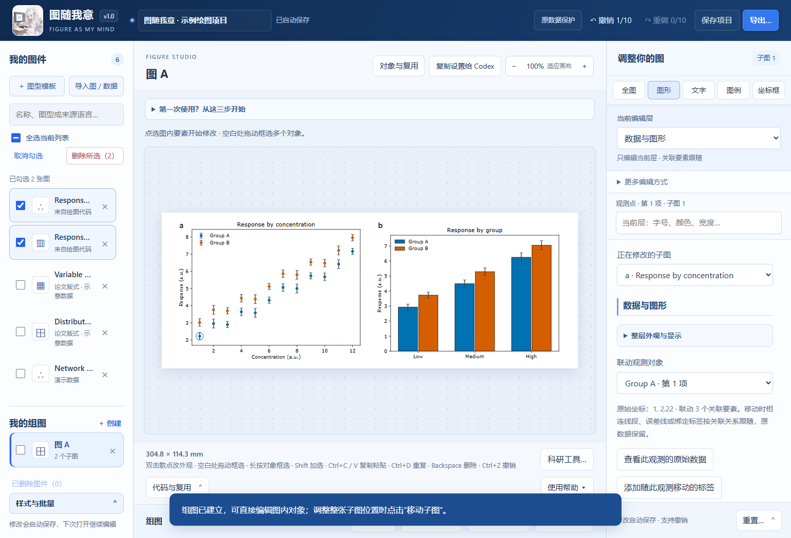

在“画布与组图”层调容器毫米尺寸、实际绘图区毫米宽高、横纵间距，以及跟随 / 独立 / 锁定模式。**等大的是坐标框的实际宽高，不是包含标题和外部留白的整张图片。** 默认跟随第一张兼容二维图；单独调整其他子图可进入独立模式，锁定后不接受布局联动。

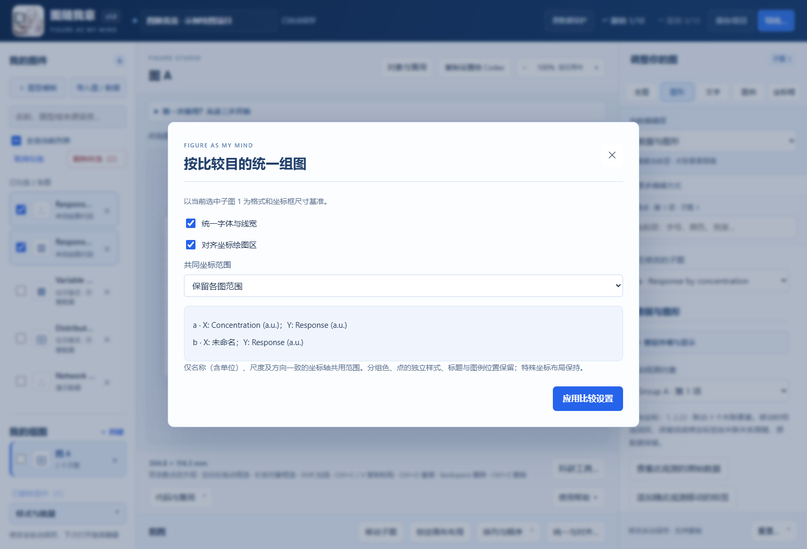

“统一与对齐…”可分别选择统一字体线宽、对齐绘图区、共同坐标范围。格式 / 绘图区以当前选中子图为参照；共同范围仅适用于名称、单位、方向和尺度可比的轴。固定比例、三维、多主轴及锁定布局保留约束，容器空间不足应扩大画布，而不悄悄缩小基准。

a、b、c 面板标注与标题可自动放置，也可单独调整。重新排列前确认移动模式和布局锁定状态，避免把修改图内对象误当成移动整张子图。

## 复用格式和批量绘图

### 复制给 Codex

点击画布上方“复制设置给 Codex”，先选择**目标绘图语言**：R、Python、MATLAB 或 C。首次默认 R，与代码导出记住同一项目的上次选择。然后点“复制设置”粘贴到对话，再说明目标图或目标变量；也可“下载设置 JSON”，文件内的 drawingLanguage 保留选择。语言选择不会修改当前图、原代码、数据或撤销历史。

展开“预览将复制的设置”可查看内容。剪贴板受限时会选中文本，按 Ctrl+C 手动复制或下载 JSON。组图包含完整组图和当前子图设置。

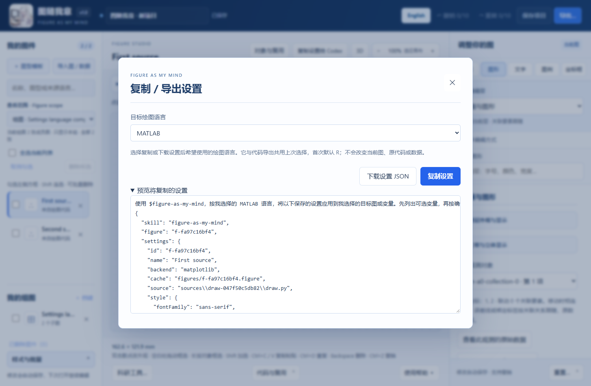

例如选择 R 后：

```text
将下面设置应用到我勾选的目标变量。
保留原始数据与统计方法；先列出可用变量让我选择，再用 R 生成新图。
只统一字体、坐标框和图例排版，各组原来的颜色与点形保留。
[粘贴复制的设置]
```

复制对象 ID 不等于跨图变量相同，Codex 应按轴 / 系列语义匹配，未识别角色需要明确说明。

### 界面批量

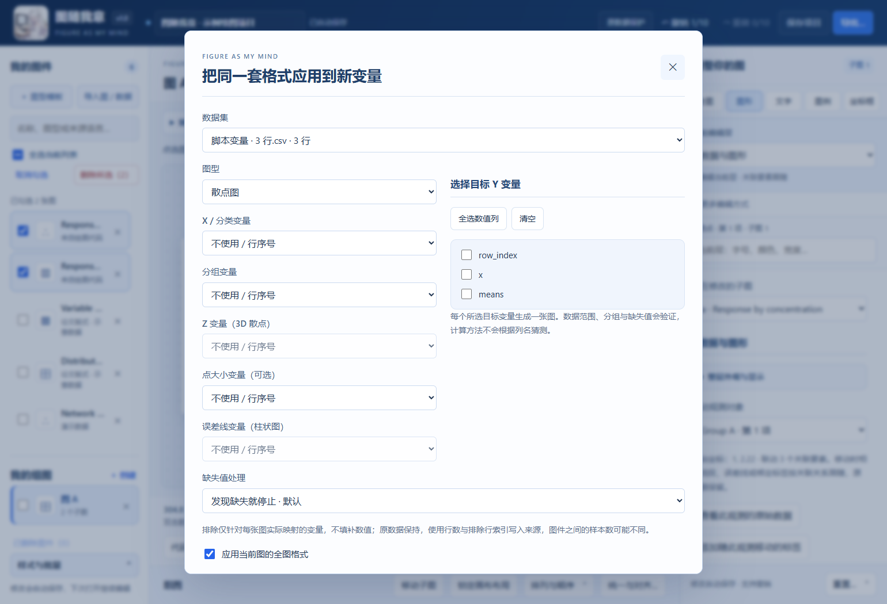

“样式与批量 → 批量绘图…”选择数据表、图型、映射、目标 Y 变量，可应用当前全图样式。目标变量可多选；矩阵型与逐变量型的含义不同，检查列的数值类型、缺失和样本数。PCA、系统发育树、组学与机器学习模型需要先有明确分析流程，不根据列名猜方法。

已有图批改可勾选图件后“应用当前样式到勾选图件”，或“同名分组配色”。精确的逐对象格式跨图复用可以通过“对象与复用”预览目标后应用。录制批绘和更复杂数据更新见“科研工具…”及对应高级参考，原数据仍只读。

## 导出投稿检查与备份

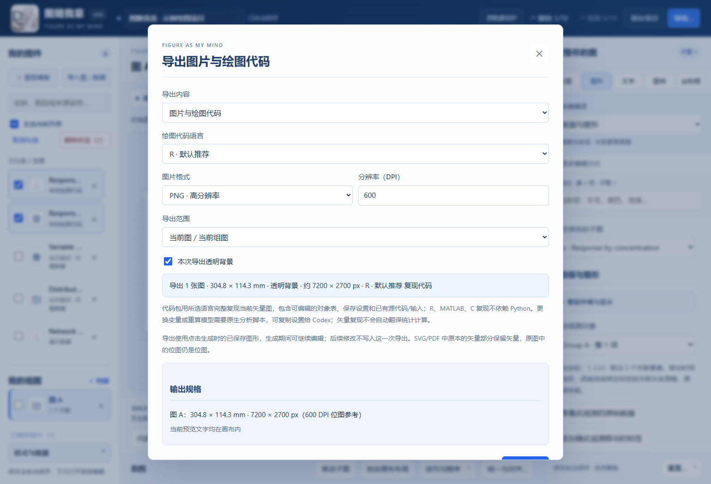

1. **导出内容：** 图片与绘图代码、仅图片或仅绘图代码。代码语言默认 R，可选 Python、MATLAB、C。
2. **图片格式：** SVG / PDF 适合矢量提交；PNG / TIFF 设置 300、600 等需要的 DPI。矢量格式无需 DPI；已有位图不会自动转成矢量。
3. **尺寸：** 先按论文实际毫米宽高排版，再看像素和字号。预设单栏 / 双栏是示例，具体以期刊要求为准。
4. **范围：** 当前图 / 当前组图、勾选项或全部。确认数量，避免把不需要的示意图一起导出。
5. **透明：** 默认透明；白色预览不代表文件有白底。不透明时才用图中设置的背景色。
6. **生成并下载：** 以点击生成时已保存的图为快照；生成期间的后续编辑不进入该次输出。多个文件可能打为 ZIP。

R / Python / MATLAB / C 的矢量复现代码按当前对象场景重放编辑和组图，同时保留声明的来源；它不是把统计模型翻译成新语言。需要换数据 / 变量时，在原分析上重绘并重接入。

“科研工具… → 投稿检查”辅助核对字、线、尺寸、来源和展示修改；它不能代替期刊规范或统计审查。显示中的越界文字需手动改位置、坐标框或画布尺寸。已取消独立“一键适配”功能。

备份用“代码与复用 → 打包整个项目…”，其中有原数据、源码、捕获和当前设置。项目不是单个 HTML：`project.fam.json` / `settings.json` 保存状态，`sources` / `figures` 保存输入与捕获，`runtime` / `reproduce.py` 支持重放，`exports` 是导出结果。仅加载自己生成的 Matplotlib 缓存，跨 Matplotlib 大版本迁移建议从源码 / 数据重导入再回放设置。

普通启动会开启掉线守护，连接失败自动打开 CMD 恢复。按[安装说明](安装与启动.md#自动恢复连接)启用登录恢复后，电脑重启也可自动恢复；未启用时重新双击启动入口。使用恢复后返回的链接。不要公开带 token 的 `.session.json` 或个人数据包。

## 接入方式决定哪些控件可用

| 接入方式 | 可以直接做 | 需要进一步接入 |
| --- | --- | --- |
| 原生 Matplotlib + 明确数据 | 逐对象、轴、常见统计画法、可识别关联、原生 XY 拟合 | 自定义模型和未知图型的专用计算 |
| R 等带语义绑定的 SVG | 通用对象与显式声明的点 / 误差 / 标签关系 | 原生统计重算与真正 3D 相机 |
| 普通 SVG | 文字、颜色、路径、装饰、布局与组图 | 未声明的观测、变量与统计方法 |
| PNG / JPG | 参考层、整体位置和大小 | 先根据原数据重绘，随后编辑重绘图 |
| 内置模板 | 体验图型和适用画法，试用多选 / 组图 / 导出 | 用你自己的真实数据替换并确认分析含义 |

遇到控件缺失或操作无效，先检查接入方式、当前层、应用范围和锁定。更多方法见 [故障排查](故障排查.md)，底层适配和字段见 skill 的 `references` 目录。


## 已有三维图为何需要先适配

若图来自二维仿射叠层或 HTML / WebGL，先让 Codex 接入原代码与明确的图层坐标，完成可编辑检查，再打开工作台。不能通过平面截图得到可旋转的三维相机。地图的层间距离若为示意，不代表测量深度。

对于已适配的分层地图，按画布上方的两步操作：

1. **编辑平面**：在“当前平面”选择底层或表层。点选“坐标框”，独立输入绘图区宽 / 高（毫米），或拖动四边 / 四角；只调整宽度时，高度保持。此时可编辑范围、字体、颜色、点、线和色标。已有图点击“1 · 返回平面编辑”进入，保留原视角与已保存设置。
2. **确认平面 → 3D**：保留平面内容及宽高比例，再调整空间旋转角、缩放、平移、投影和“图层间距（相对平面高度）”。想再改平面内容，随时返回第一步。保存后重开沿用当前阶段，切换也可撤销；组图仅修改当前子图。

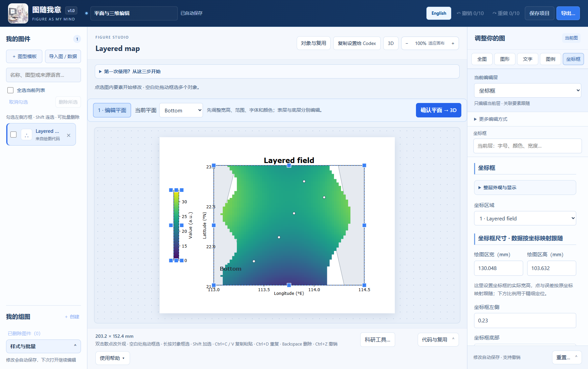

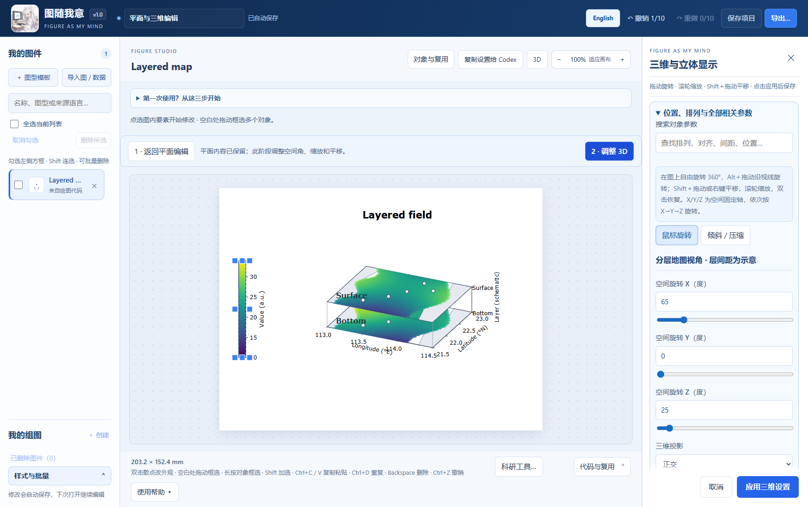

三维阶段左键拖动旋转、滚轮缩放，Shift / 右键拖动平移；右侧精调，应用后可撤销。三维投影中不直接拖动坐标框宽高，先返回平面调整，避免宽高相互牵连。普通真实 XYZ 散点 / 曲面等图仍直接使用原生三维编辑。

修改经纬度范围在平面阶段使用 **坐标框 → 调整坐标轴范围…**，也可右键绘图区。图例与色标层的八个手柄可调整色条宽高；双击色标编辑梯度和数值映射。细色条的手柄会适当向外分开，方便点中。

修改范围只裁剪显示，不改网格或观测。需要重算空间插值时，回到原语言代码与原数据处理；当前相机和颜色调整不会重新运行分析。Codex 应验证实际来源图的交互、保存和导出后再提供链接。


三维范围变化会联动框架与数据显示：层边框、角点连线、默认刻度和层名按新范围更新；海岸线、数据线、误差与面片按原坐标裁剪。扩展到无数据区时显示空白，不补造数据。自定义刻度保留；原始输入、捕获与原分析不改写。
